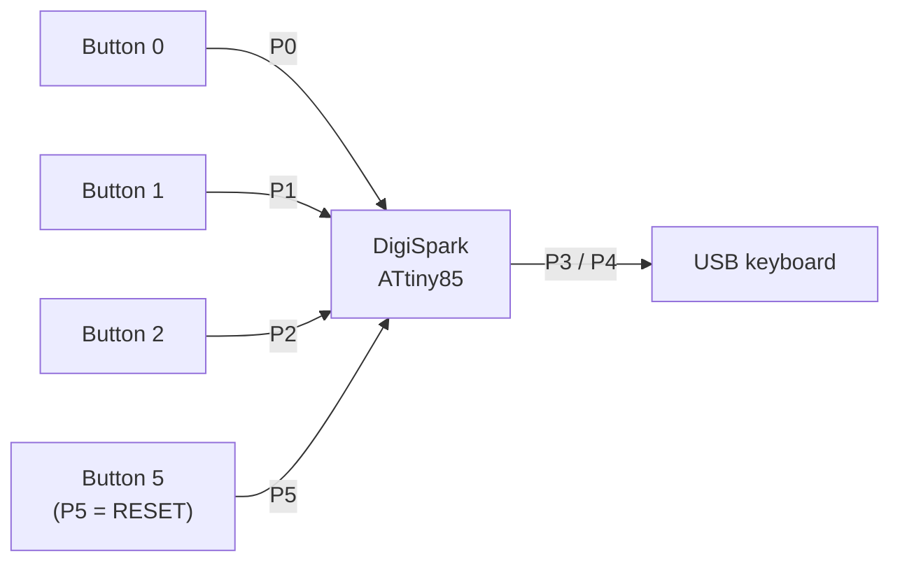

# Wiring

The DigiSpark exposes six I/O pins, but two of them are the USB data lines and
one is the ATtiny85 reset pin. That leaves three pins that are always safe for
buttons, plus P5 with a caveat.

## Pin map

| Function | DigiSpark pin | ATtiny85 pin | Safe for a button? |
|---|---|---|---|
| Button 0 | P0 | PB0 | yes |
| Button 1 | P1 | PB1 | yes, shares the onboard LED |
| Button 2 | P2 | PB2 | yes |
| Button 5 | P5 | PB5 / RESET | only with `RSTDISBL` |
| USB D− | P3 | PB3 | no |
| USB D+ | P4 | PB4 | no |
| +5 V | 5V | VCC | — |
| Ground | GND | GND | — |

## Active-high wiring (matches the original, and the practical four-button build)

The original firmware used `INPUT` without a pull-up and treated `HIGH` as
pressed. That wiring is:

```
              +5 V
                |
          [ button ]
                |
P0 -------------+----[ 10k ]---- GND
```

Repeat for P0 and P2. P5 can be added only after the reset fuse is disabled
(see below). Set `BUTTON_ACTIVE_LOW = false` (the default).

P1 is the exception: the onboard LED and its resistor already act as a
pull-down, so P1 does not need the external 10 kΩ resistor. The LED lights
while button 1 is pressed, which is a useful indicator.

The 10 kΩ pull-down is not optional on P0/P2/P5. Without it the input floats
when the button is open, and the firmware will see random presses. The
original sketch had the same exposure; if the pedal has ever sent keys on its
own, this is why.

If you use P5, read the reset warning below first.

## Active-low wiring (P0, P2 and P5 only)

Wire each button between the pin and ground:

```
P0 ----[ button ]---- GND
P2 ----[ button ]---- GND
P5 ----[ button ]---- GND
```

Set `BUTTON_ACTIVE_LOW = true` in `firmware/footcontroller/config.h`. The
firmware enables the ATtiny85's internal pull-up on each pin, so no external
resistors are needed.

**Do not wire P1 active-low** unless you remove the onboard LED or its
resistor. The LED clamps P1 at its forward voltage, which is below the
ATtiny85's logic-high threshold; the input can read as permanently pressed.
Because `BUTTON_ACTIVE_LOW` applies to every button, a four-button build
should stay active-high.

## P5 is RESET

On a stock ATtiny85, PB5 is the RESET pin. It can be used as an input only if
the `RSTDISBL` fuse is programmed. Programming that fuse:

- disables the reset pin, freeing P5 as an I/O;
- disables ISP programming, so recovery from a bad bootloader needs a
  high-voltage programmer (HVSP);
- does not stop the micronucleus USB bootloader from working.

Some DigiSpark clones ship with `RSTDISBL` already programmed; many do not.
With RESET enabled, P5 is held high internally, so active-high wiring reads as
permanently pressed and active-low wiring resets the board. In neither case
does button 4 work as a normal input. The safe options are to use three
buttons, move to a DigiSpark Pro (ATtiny167) or another board with more I/O,
or accept the fuse change and keep an HVSP programmer available.

## P1 and the onboard LED

On a Model A DigiSpark, P1 drives the onboard LED through a resistor to
ground. Button 1 shares that pin:

- With active-high wiring, the LED path acts as a weak pull-down. That is
  probably why the original pedal worked on P1 without external resistors, and
  the LED lights while the button is pressed.
- With active-low wiring, the internal pull-up is clamped by the LED. P1 can
  sit below the logic-high threshold and read as permanently pressed, so do
  not use active-low on P1 unless you remove the LED or its resistor.

## USB pins

P3 and P4 are the USB D− and D+ lines. Do not connect buttons to them; the
keyboard will not enumerate.

## Diagram


